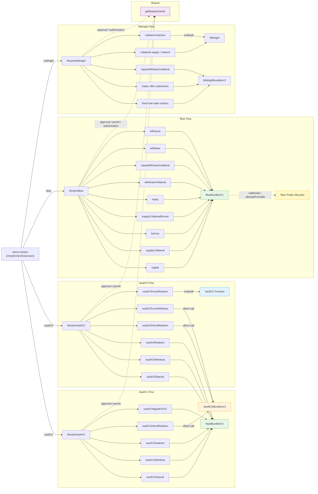

# @morpho-org/morpho-sdk

[](https://www.npmjs.com/package/@morpho-org/morpho-sdk)
[](https://www.typescriptlang.org/)
[](./LICENSE)
[](https://github.com/morpho-org/morpho-sdk/actions/workflows/ci.yml)

> 📖 **Full documentation → [docs.morpho.org/developers/sdks/morpho-sdk](https://docs.morpho.org/developers/sdks/morpho-sdk/)**

Build transactions for Morpho's **VaultV1** (MetaMorpho), **VaultV2**, **Blue**, and **Midnight** fixed-rate markets on chains with the required protocol and periphery deployments. Custom deployments can be added with `registerCustomAddresses` from `@morpho-org/morpho-sdk/addresses`.

## Removed in v6

Vault V1 PublicAllocator APIs, low-level Bundler3 composition, migration adapters, and legacy
MORPHO wrapping were removed. Use Vault V2 BluePublicAllocator APIs:
`getVaultV2BlueReallocationData()` fetches the state and `getVaultV2BlueReallocations()` prepares a
plan for a Blue action.

General Vault V1 operations remain supported.

## Installation

```bash
npm install @morpho-org/morpho-sdk
```

Read [Dead-share validators](./DEAD-SHARE-PROTECTION.md) for the exported checks. Builders do not
enforce the dead-deposit rule; integrators should validate their snapshot before building.
Snapshot-free Blue `supply` remains deprecated.

Upgrading from v9? Read the [v9 → v10 migration guide](./MIGRATION-v9-to-v10.md) for the direct
Midnight `cancelOffers` route.

Upgrading from v8? Read the [v8 → v9 migration guide](./MIGRATION-v8-to-v9.md) for the approval
API removals and the new unlimited-approval behavior.

Upgrading from v6? Read the [v6 → v7 migration guide](./MIGRATION-v6-to-v7.md) before updating
Midnight maker integrations. Upgrading from v7? Read the
[v7 → v8 migration guide](./MIGRATION-v7-to-v8.md) before relying on fail-closed token metadata or
permit requirement errors. The guide also covers wrong-chain RPC checks (`eth_chainId`)
on entity reads and requirement resolvers. It also covers missing-contract checks. Upgrading from
v5? Read the
[v5 → v6 migration guide](./MIGRATION-v5-to-v6.md) before updating vault deposit or Blue write
integrations.

## Actions

Each entity exposes a set of actions. Common vault writes call VaultBundlesV1, Blue writes call
BlueBundlesV1, and the remaining rows identify their destination.

| Entity | Actions | Route |
| --- | --- | --- |
| **VaultV1** (MetaMorpho) | `deposit`, `withdraw`, `redeem`, `migrateToV2` | VaultBundlesV1 |
| | `inKindRedeem` | VaultExitBundlesV1 |
| **VaultV2** | `deposit`, `withdraw`, `redeem` | VaultBundlesV1 |
| | `forceWithdraw` | VaultExitBundlesV1 |
| | `forceRedeem` | Vault multicall |
| | `inKindRedeem` | VaultExitBundlesV1 |
| **Blue** | `supply`, `withdraw`, `supplyCollateral`, `borrow`, `supplyCollateralBorrow`, `repay`, `withdrawCollateral`, `repayWithdrawCollateral`, `refinance` | BlueBundlesV1 |
| **Blue** | `withdrawBuyCallback` | Morpho Blue (direct `withdraw` for a BlueBuyCallback's owner) |
| **Midnight** | `takeLend`, `takeBorrow`, `supplyCollateralTakeBorrow`, `takeRepayWithdrawCollateral`, `repayWithdrawCollateral`, `takeWithdraw` | MidnightBundlesV2 (Ethereum, Base, Arbitrum, Arc, Robinhood, Tempo) |
| | `supplyCollateral`, `withdrawCollateral`, `redeem` | Direct call |
| | `supplyCollateralBatch`, `withdrawCollateralBatch` | Midnight multicall |
| | `cancelOffers` | Direct call for one group (`setConsumed`), Midnight multicall for several; every Midnight chain |
| | `makeLend`, `makeBorrow`, `makeWithdraw`, `makeRepay`, `supplyCollateralMakeBorrow`, `supplyBlueMakeLend` | MidnightBundlesV2 (Ethereum, Base, Arbitrum, Arc, Robinhood, Tempo) |

`makeBorrow` publishes without collateral; `supplyCollateralMakeBorrow` requires collateral and
supplies it in the same transaction.

`makeWithdraw` publishes reduce-only sell offers for lend limit exits. `makeRepay` publishes
reduce-only buy offers for borrow limit exits; its `loanAssets` input only sets the
minimum Midnight allowance that `getRequirements()` checks (the approval it returns is
unlimited), while the signed offer caps bound fills.
Both preserve the supplied offer tree and use `midnightCancelAndMake`; neither executes a fill
or withdraws collateral during publication. Send their approval/authorization requirements first,
then call `buildTx()` without a separate root signature.

`VaultExitBundlesV1`, `VaultBundlesV1`, and `BlueBundlesV1` are registered on Ethereum, Base,
Arbitrum, Optimism, Polygon, World Chain, Unichain, HyperEVM, Katana, Monad, Stable, Tempo,
Robinhood Chain, Arc, X Layer, and Alpen. Alpen has no registered Vault V1 factory, wrapped-native
token, or Permit2; native-token funding is not enabled there. Custom deployments can still be
configured with `registerCustomAddresses`.

## How it works

Actions that pull tokens or touch a position return `{ buildTx, getRequirements }`. All Blue
writes use this lazy shape while still encoding one direct BlueBundlesV1 call, except
`withdrawBuyCallback`, which encodes one direct Morpho Blue `withdraw`. Vault deposits,
`withdraw`, and `redeem` use the same shape for token or vault-share authorization to
VaultBundlesV1. Vault `inKindRedeem` and `forceWithdraw` use it so callers can await
`getRequirements()` to check share authorization to VaultExitBundlesV1 — and, for `inKindRedeem`,
live Blue liquidity — before invoking `buildTx()`. Calling `buildTx()` directly skips those
RPC-backed pre-flight checks. `forceRedeem` remains a direct Vault V2 multicall without
prerequisites.

- **`getRequirements()`** — async; the on-chain prerequisites to satisfy first: ERC-20 approvals, ERC-2612 permit signatures, Morpho authorization, or (for Midnight) operator authorization.
- **`buildTx(signatures?)`** — synchronous; the final, deep-frozen viem transaction. Pass any signatures collected from the requirements.

Every transaction carries `tx.action` — typed metadata describing the encoded call (`type` plus
the normalized `args`, including `referralFeeAssets`: the exact referral-fee amount the
BlueBundlesV1 call charges, where derivable; it is omitted in exact-shares mode
(`blueWithdraw`, `blueRepay` and `blueRepayWithdrawCollateral` with a shares input),
where the underlying amount is resolved at execution. On the repay actions it is set
only for an exact-assets repay (`repayAssets > 0n`), so it is also omitted when
`blueRepayWithdrawCollateral` has no repay leg).
`@morpho-org/evm-simulation`'s `toSimulationLimits` consumes this metadata
for quote-based limits. For operations covered by `OperationInputs`, prefer
independently chosen `inputs` in `simulate()` limits rather than bounds derived
from action metadata. Refinance, in-kind redeems, force exits and Midnight
operations still require quotes.

```typescript
const vaultData = await vault.getData();
const { buildTx, getRequirements } = vault.deposit({ amount, userAddress, vaultData });

const requirements = await getRequirements();
// Send each approval tx and collect each signature, then:
const tx = buildTx([permitSignature]);
```

Enable off-chain approvals (ERC-2612 permits) with `morphoViemExtension({ supportSignature: true })`. Pass `getRequirements({ useSimplePermit: false })` to force direct ERC-20 approvals; unsupported tokens also fall back to direct approvals.

Token funding checks the bundles allowance first on every route. If it already covers the amount,
no token requirement is returned and ERC-2612 support is not probed.

### `userAddress` is the eventual submitter

`userAddress` must be the account that eventually signs and sends the transaction. A connected
builder account may prepare a direct bundles call for a different submitter; signature helpers
enforce the expected identity at `sign()`. VaultBundlesV1 and BlueBundlesV1 always operate on
`msg.sender`.

## Usage

```typescript
import {
  morphoViemExtension,
  isRequirementSignature,
} from "@morpho-org/morpho-sdk";
import { createPublicClient, createWalletClient, custom, http } from "viem";
import { mainnet } from "viem/chains";

// Reads on-chain state, extended with the `morpho` namespace.
const client = createPublicClient({ chain: mainnet, transport: http() }).extend(
  morphoViemExtension(),
);

// Signs permits and sends the approval / authorization transactions.
const walletClient = createWalletClient({
  account: "0xUser...",
  chain: mainnet,
  transport: custom(window.ethereum), // any EIP-1193 provider
});
```

Create an entity — every factory takes a chain ID as its last argument:

- `client.morpho.vaultV1(address, chainId)` / `client.morpho.vaultV2(address, chainId)`
- `client.morpho.blue(marketParams, chainId)`
- `client.morpho.midnight(chainId)`

### Vault deposit / withdraw

Deposit calls VaultBundlesV1 and may require an approval or permit. ERC-20 approvals and ERC-2612
permits authorize VaultBundlesV1. The SDK no longer requests Permit2 funding.

```typescript
const vault = client.morpho.vaultV2("0xVault...", 1);
const vaultData = await vault.getData();
const { buildTx, getRequirements } = vault.deposit({
  amount: 1000000000000000000n,
  userAddress: "0xUser...",
  vaultData,
});
const requirements = await getRequirements();
const tx = buildTx([permitSignature]);
```

Withdraw is a VaultBundlesV1 call that burns the caller's shares. Any existing allowance at or
above the required share amount is reused; otherwise, `getRequirements()` returns an unlimited
approval or permit:

```typescript
import { morphoViemExtension } from "@morpho-org/morpho-sdk";
import {
  createPublicClient,
  createWalletClient,
  custom,
  http,
  type EIP1193Provider,
} from "viem";
import { mainnet } from "viem/chains";

async function withdrawUsdc(provider: EIP1193Provider, supportSignature = false) {
  const client = createPublicClient({ chain: mainnet, transport: http() }).extend(
    morphoViemExtension({ supportSignature }),
  );
  const walletClient = createWalletClient({ chain: mainnet, transport: custom(provider) });
  const [userAddress] = await walletClient.requestAddresses();
  if (!userAddress) throw new Error("Connect a wallet account before withdrawing.");
  const vault = client.morpho.vaultV2("0x04422053aDDbc9bB2759b248B574e3FCA76Bc145", mainnet.id);
  const vaultData = await vault.getData();
  const withdrawal = vault.withdraw({ amount: 500_000n, userAddress, vaultData });
  const requirements = await withdrawal.getRequirements();
  const requirement = requirements[0];

  if (requirement && "sign" in requirement) {
    // With signature support enabled, sign the vault-share permit for this handle.
    const signedPermit = await requirement.sign(walletClient, userAddress);
    return walletClient.sendTransaction({
      ...withdrawal.buildTx([signedPermit]),
      account: userAddress,
    });
  }

  for (const approval of requirements) {
    if ("to" in approval) {
      const hash = await walletClient.sendTransaction({ ...approval, account: userAddress });
      const receipt = await client.waitForTransactionReceipt({ hash });
      if (receipt.status !== "success") throw new Error("The share approval reverted.");
    }
  }
  // Approval is confirmed, or the required allowance was already satisfied.
  return walletClient.sendTransaction({ ...withdrawal.buildTx(), account: userAddress });
}
// await withdrawUsdc(provider) returns the withdrawal transaction hash.
// Pass true as the second argument to use a signed share permit instead of an approval.
```

For wNative vaults, pass `nativeAmount` instead of `amount`. The transaction sends that amount as
`tx.value` to VaultBundlesV1, which wraps it internally; native deposits require no token permit.

### Blue: BlueBundlesV1 writes

```typescript
const market = client.morpho.blue(
  {
    loanToken: "0xLoan...",
    collateralToken: "0xCollateral...",
    oracle: "0xOracle...",
    irm: "0xIrm...",
    lltv: 860000000000000000n,
  },
  1,
);

const { buildTx, getRequirements } = market.supplyCollateralBorrow({
  userAddress: "0xUser...",
  collateralAssets: 1_000_000n,
  borrowAssets: 0n,
  deadline: 1_900_000_000n,
});

// Satisfy each BlueBundlesV1 approval or signature requirement, then pass every
// collected signature to buildTx.
const signatures = [];
for (const requirement of await getRequirements()) {
  if (isRequirementSignature(requirement)) {
    signatures.push(await requirement.sign(walletClient, "0xUser..."));
  } else {
    await walletClient.sendTransaction(requirement); // approval / authorization tx
  }
}

const tx = buildTx(signatures);
```

Set `borrowAssets` to a non-zero amount and provide `positionData` to combine collateral supply and
borrowing. That path may also require Morpho authorization for BlueBundlesV1. Optional
`reallocations` are Vault V2 only, and the LLTV buffer guards the resulting position against
instant liquidation. Blue writes do not accept `slippageTolerance`, `minSharePrice`, or
`maxSharePrice` because BlueBundlesV1 has no share-price-bound inputs.

> High-level Blue writes and shared-liquidity planning use Vault V2 only. Vault V1 allocator and
> low-level composition surfaces were removed in v6; direct Vault V1 flows remain.

### TransactionPlan: sign and verify permits

> **Beta:** TransactionPlan is experimental; breaking changes may ship in minor releases.
> Existing entity flows remain the recommended stable path during the shadow-mode rollout.

Preparers emit stored format `version: 2`. Version 1 (including SDK 9.7.0 plans) is rejected with
`UnsupportedTransactionPlanVersionError`; migrate trusted saved plans' fields and version before
restoring them. There is no legacy parser.

Prepare a Vault V2 deposit, withdrawal, force-withdraw or exact-share redemption plan, or a Vault V1 deposit or withdrawal plan with
`prepareVaultV1Deposit` or `prepareVaultV1Withdraw` and a `fetchAccrualVault` snapshot, then sign its pending requests with your wallet.
Deposit and withdrawal preparers take `assets`; redemption takes `shares`. Stored operation inputs
use the same names, except native-funded deposits store `nativeAssets` instead of `assets`.
Stored ERC-20 approval inputs likewise use `assets` for underlying-token approvals or `shares`
for vault-share approvals. See the [TransactionPlan format and migration notes](./src/transactionPlan/README.md).
Pass the caller-fetched `AccrualVault` (V1) or `AccrualVaultV2` (V2) once as `vault` for deposits,
and the matching snapshot as `vault` for withdrawals;
the contract address comes from `vault.address`. Only deposit preparation accepts `deployless`.

V1 and V2 deposits share preparation and validation; use `assets` for either preparer and
`nativeAssets` in stored native funding. The snapshot is not retained in the stored plan.

V1 and V2 withdrawal plans also share preparation and validation: both prepare and store gross
`assets`, alongside the stored `requiredShareAllowance` quote. Neither accepts a slippage override.

`prepareVaultV1Redeem` prepares a Vault V1 exact-share redemption. Its required `shareToken: Token`
supplies the vault address and share-permit domain metadata; no accrual snapshot is required.

V1 and V2 redemptions both prepare and store exact `shares`. Their shared authorization resolver
also serves ordinary withdrawals: chain checks, code checks and requirements run concurrently,
while the requirements helper checks the RPC chain before allowance or nonce reads.

Migration plans take exactly one of `assets` or `shares`, store `vault: sourceVault` and derived
`maxSharePrice`, and translate that bound to the entity/ABI `maxSharePriceVaultV2` argument.
Pass the caller-fetched source and target snapshots once each, as `sourceVault: AccrualVault` and
`targetVault: AccrualVaultV2`. Their assets must match and their addresses must differ.

`applySignatures(plan, signatures)` synchronously verifies every supplied signature before attaching
it, without a client or RPC. It validates all requests against their actions, including permit/action
deadline agreement, rejects unknown or duplicate input IDs, and recovers the permit owner from the
EIP-712 typed-data hash. The domain
binds the signature to its chain. Only low-s ECDSA permits encodable as `v/r/s` are supported
(64-byte compact or 65-byte serialized signatures, stored in serialized form). Contract wallets
should use `supportSignature: false` for direct approvals: deployed bundles do not consume
arbitrary ERC-1271 or ERC-6492 signatures.

`parseTransactionPlan` revives bigint tags and validates supported versions/actions, field shapes
and uint256 ranges, unique IDs, references, action chain/account agreement and permit consistency,
including requests with existing signatures. It allows extra keys. Malformed JSON, shapes or
references throw `InvalidTransactionPlanError` with a JSON `path` and `reason`; unsupported versions
and action types retain their dedicated errors. Serialization remains unchecked. Parsing verifies
stored signatures against their expected signers offline and rejects signatures from the wrong
signer. It uses no clock or RPC and does not check expiry, live state or action-layer business
constraints. A successful parse does not prove intent or protect unsigned fields, so integrators
must still protect stored plans.

Supported action types are `erc20Approval`, `morphoAuthorization`, `blueSupply`,
`blueSupplyCollateral`, `blueSupplyCollateralBorrow`, `vaultV1Deposit`, `vaultV1Withdraw`,
`vaultV1Redeem`, `vaultV1InKindRedeem`, `vaultV1MigrateToV2`,
`vaultV2Deposit`, `vaultV2Withdraw`, `vaultV2Redeem`,
`vaultV2ForceWithdraw`, `vaultV2ForceRedeem` and `vaultV2InKindRedeem`. Builders return plain `Readonly<Transaction>` objects without step metadata.

| Prepare function | Operation |
| --- | --- |
| `prepareBlueSupply` | Supply loan assets to a Blue market |
| `prepareBlueSupplyCollateral` | Supply collateral to a Blue market without borrowing |
| `prepareBlueSupplyCollateralBorrow` | Supply collateral, borrow, or perform both atomically on Blue |
| `prepareVaultV2Deposit` | Deposit assets into Vault V2 |
| `prepareVaultV2Withdraw` | Withdraw assets from Vault V2 |
| `prepareVaultV2Redeem` | Redeem an exact number of Vault V2 shares |
| `prepareVaultV2ForceWithdraw` | Force-withdraw a penalty-inclusive asset amount from Vault V2 |
| `prepareVaultV2ForceRedeem` | Force-deallocate and redeem an exact number of Vault V2 shares |
| `prepareVaultV2InKindRedeem` | Exit a penalty-inclusive asset amount from Vault V2 in kind (idle assets and Blue supply positions) |
| `prepareVaultV1Deposit` | Deposit assets into Vault V1 |
| `prepareVaultV1Withdraw` | Withdraw assets from Vault V1 |
| `prepareVaultV1Redeem` | Redeem an exact number of Vault V1 shares |
| `prepareVaultV1InKindRedeem` | Redeem Vault V1 shares in kind |
| `prepareVaultV1MigrateToV2` | Migrate exclusive `assets` or `shares` from Vault V1 into Vault V2 |

`prepareBlueSupply` takes a caller-fetched market snapshot. With insufficient ERC-20 allowance,
it requests an unlimited approval or an exact-amount ERC-2612 permit for BlueBundlesV1.
Native funding is available only when the loan token is the chain's wrapped native token (wNative)
and requires neither an approval nor a permit. Like deposit preparers, supply preparation takes
`assets` with `funding: { type: "native" }`; the stored supply action retains gross `assets` and
records the native funding as `nativeAssets`.

`prepareBlueSupplyCollateral` takes a caller-fetched market snapshot and `collateralAssets`.
With insufficient ERC-20 allowance, it requests an unlimited approval or an exact-amount ERC-2612
permit for BlueBundlesV1. Native funding is available only for wNative collateral, needs neither
approval nor permit, and stores `nativeAssets` equal to `collateralAssets`.

`prepareVaultV2ForceRedeem` takes `vaultAddress` and top-level `shares`, with no snapshot.
Caller-supplied `deallocations[].assets` and `shares` are fixed on one `vaultV2ForceRedeem` step
with no approvals or signature requests. It accepts neither `supportSignature` nor `deployless`.
`expiresAt` is plan metadata only, not an onchain deadline.

`prepareVaultV2Deposit` and `prepareVaultV2Withdraw` take one `vault: AccrualVaultV2` snapshot.
`prepareVaultV1MigrateToV2` takes `sourceVault: AccrualVault` and `targetVault: AccrualVaultV2` snapshots.

Preparers with token authorization default to `supportSignature: false`. With `true`, ERC-2612 tokens use permits and other
tokens fall back to direct approval; no Permit2 or fetch requests are generated. Callers fetch
snapshots before preparation. Builders return plain SDK transactions without step IDs or kinds.

When existing allowance is insufficient, withdrawal, redemption and migration plans request an unlimited (`maxUint256`)
ERC-2612 vault-share permit or direct share approval. The quote's `requiredShareAllowance` remains
the minimum needed for that exit; later exits reuse sufficient allowance without a
new signature. Deposit asset permits must instead sign the exact pull amount, not an unlimited
value. Finite format-2 withdrawal permits that cover the quoted minimum allowance remain valid;
this finite-permit compatibility does not apply to force-withdraw plans.

Deposit and migration plans accept `slippageTolerance`, which sets their on-chain maximum share price.
`vaultV1Withdraw` and `vaultV2Withdraw` plans do not accept it: the share-allowance quote uses `DEFAULT_SLIPPAGE_TOLERANCE`
internally, but these ordinary withdrawals have no on-chain share-price or maximum-shares bound. A price drop
before inclusion can burn more shares than quoted.

`vaultV1InKindRedeem` and `vaultV2InKindRedeem` are also asset-denominated, with no on-chain share-price or maximum-shares
bound. A price drop before inclusion can burn more shares than quoted.
Each preparer takes one caller-fetched `vault` snapshot (`AccrualVault` for V1, `AccrualVaultV2`
for V2) and no `deployless` option.
V1 and V2 prepare and stored in-kind quantities use `assets`; builders translate to the stable entity/ABI
`amount`. Share approvals store `shares`, while ERC-2612 typed data retains `value`.

Use `prepareVaultV2ForceWithdraw` with one caller-fetched `vault: AccrualVaultV2` snapshot for a
penalty-inclusive asset exit; it accepts no `deployless` option. Prepare and stored `assets`
include the penalty. Optional `slippageTolerance` derives the stored on-chain `minSharePriceE27`
floor from the snapshot, using the entity default when omitted; plans accept no raw floor override.
Share allowances and permits target VaultExitBundlesV1, and any permit
must be unlimited (`maxUint256`).

`prepareVaultV2ForceRedeem` takes `vaultAddress`, top-level `shares`, and ordered deallocations
with `assets`. It creates a native vault multicall with no `supportSignature` or `deployless`
option. Stored inputs retain `vault` and `redeem.shares`; the entity method is unchanged.

Use `prepareVaultV2Redeem(client, { shareToken, chainId, account, shares, supportSignature })`
to burn exactly `shares`; pass the account's share balance for a full redemption.
`supportSignature` defaults to `false` (direct approval); `true` uses an ERC-2612 share
permit when allowance is insufficient. No Permit2 is used. Exact-share redemption needs
no quote: `shareToken: Token` is required, but an address-only `new Token({ address })` is sufficient.
An accrual snapshot also satisfies `Token`. Redemption sets no minimum assets received and accepts
neither `slippageTolerance` nor `deployless`.
Plans are serializable data; `buildTransaction` and `buildTransactions` return plain
frozen SDK transactions without step `id` or `kind` fields.

```typescript
import {
  buildTransactions,
  getPendingSignatureRequests,
  applySignatures,
  type TransactionPlan,
} from "@morpho-org/morpho-sdk";
import type { WalletClient } from "viem";
import { signTypedData } from "viem/actions";

async function finalize(wallet: WalletClient, plan: TransactionPlan) {
  const signatures = await Promise.all(
    getPendingSignatureRequests(plan).map(async ({ id, typedData }) => ({
      id,
      signature: await signTypedData(wallet, { ...typedData, account: plan.account }),
    })),
  );
  return buildTransactions(applySignatures(plan, signatures));
}
```

Parsing, inspection and builders reverify stored signatures offline against their requests and
actions. Permits bind owner, token, spender, value, nonce, deadline and chain; Morpho authorizations
bind owner, authorized address, nonce, deadline and chain, not operation amounts, markets or referral
fees/recipients. Integrators must protect those unsigned fields and check that the plan matches their
intent. Empty signature input still validates all requests and returns the original plan; omitted
IDs retain their existing signatures. Supplied IDs can replace invalid stored signatures, but every
replacement is verified.

### Midnight: take a fixed-rate offer

Protocol-specific names are qualified in shared facades, for example `fetchBluePosition` and `fetchMidnightPosition` from `@morpho-org/morpho-sdk/fetch`. Canonical raw upstream names remain available under `/blue/{abis,addresses,constants,entities,errors,fetch,types,utils}` and `/midnight/{abis,constants,entities,errors,fetch,types,utils}`.

Morpho-ts registers MidnightBundlesV2 on Ethereum, Base, Arbitrum, Arc, Robinhood, and Tempo.

```typescript
const midnight = client.morpho.midnight(8453);
const marketData = await midnight.getMarketData(marketId);

const output = midnight.takeLend({
  accountAddress: lender,
  marketData,
  target: { type: "assets", assets: 1_000_000n, minUnits: 900_000n },
  takeableOffers: quote.data.takeableOffers,
  maxContinuousFee: maxUint256,
  deadline,
});

const requirements = await output.getRequirements();
const tx = output.buildTx();
```

### Midnight: collateral batches

`supplyCollateralBatch` and `withdrawCollateralBatch` move several collaterals of one position in
one transaction: a Midnight core `multicall` of direct `supplyCollateral` or `withdrawCollateral`
calls that reverts as a whole. Pass one entry per collateral index; duplicates throw
`DuplicateMidnightCollateralIndexError`, unlike the bundle flows, which sum them.

A supply batch returns one unlimited Midnight approval per collateral token whose allowance is
below that token's total:

```typescript
const supply = midnight.supplyCollateralBatch({
  accountAddress: user,
  marketData,
  collateralSupplies: [
    { collateralIndex: 0n, assets: 1_000_000n },
    { collateralIndex: 1n, assets: 2_000_000_000_000_000_000n },
  ],
});

for (const approval of await supply.getRequirements()) {
  const hash = await walletClient.sendTransaction({ ...approval, account: user });
  await client.waitForTransactionReceipt({ hash });
}
await walletClient.sendTransaction({ ...supply.buildTx(), account: user });
```

A withdraw batch checks every entry against `positionData` and, when the position has debt, checks
the remaining collateral against the LLTV buffer using `collateralPrices`. `maxUint256` withdraws
that index's whole balance. It needs no requirements:

```typescript
import { blueOracleAbi } from "@morpho-org/morpho-sdk/abis";
import { maxUint256 } from "viem";

const positionData = await midnight.getPositionData({ marketId, accountAddress: user });
const collateralPrices = await Promise.all(
  marketData.params.collateralParams.map(({ oracle }) =>
    client.readContract({ address: oracle, abi: blueOracleAbi, functionName: "price" }),
  ),
);

const withdrawal = midnight.withdrawCollateralBatch({
  accountAddress: user,
  marketData,
  positionData,
  collateralPrices,
  collateralWithdrawals: [
    { collateralIndex: 0n, assets: 500_000n },
    { collateralIndex: 1n, assets: maxUint256 },
  ],
  receiver: user,
});
await walletClient.sendTransaction({ ...withdrawal.buildTx(), account: user });
```

See the [documentation](https://docs.morpho.org/developers/sdks/morpho-sdk/) for the full API:
native wrapping, Vault V2 BluePublicAllocator reallocations, borrow-position migration, vault V1 →
V2 migration, force withdraw/redeem, and Midnight maker flows.

## Architecture



## Development

Link this package to your app for local debugging:

```bash
# In this morpho-sdk project
bun run build
bun link
```

```bash
# In your other project
bun link @morpho-org/morpho-sdk
```

Contribute from the monorepo root. See [CONTRIBUTING.md](../../CONTRIBUTING.md) for setup, checks, and package workflow. Report vulnerabilities through [SECURITY.md](../../SECURITY.md).

## License

MIT. See [LICENSE](./LICENSE).
